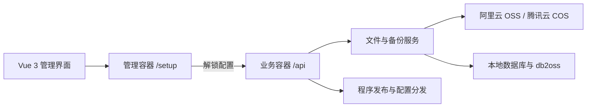

# Hive OSS

`hive-oss` 是 Hive 的对象存储管理与数据库备份应用。它以 Spring Boot 提供后端服务，并内置 Vue 3 管理界面，可统一管理阿里云 OSS 与腾讯云 COS 中的文件。

## 功能概览

- 按分类和分组浏览、搜索文件，并执行上传、下载、解冻、删除和远端同步。
- 管理分类与分组，并将文件记录同步到本地数据库。
- 编排 MySQL 数据库备份与恢复：`hive-oss` 负责业务流程及 OSS 文件流转，`db2oss` starter 负责本地备份和恢复过程。
- 通过管理界面加载或解锁秘密配置；业务服务仅在配置解锁后启动。
- 可选地发布程序包和加密配置，并为新安装签发带临时下载链接的 manifest。

## 应用结构

应用先启动管理容器，提供静态前端和 `/setup` 配置接口。解锁配置后，管理器再创建独立的业务 Web 容器；业务 API 使用 `/api` 前缀。两个容器共用 HTTP 端口，各自管理 Spring MVC 和 Controller。

主入口为 `cc.cc3c.hive.oss.setup.HiveOssApplication`。Java 代码位于 `src/main/java/cc/cc3c/hive/oss/`：`setup` 管理启动与配置，`runtime` 注册业务容器，`business` 提供业务接口和服务。前端源码由 `hive-oss-frontend` 模块维护。如需功能、接口或前端页面的详细说明，请查看 [`docs/`](docs/) 下的文档，例如 [后端 API](docs/backend-api.md)、[服务编排](docs/service-orchestration.md) 和[静态前端](docs/static-frontend.md)。

## 运行与发布

开发和运行环境需要 Java 21。可从 IDEA 运行主入口进行本地开发；源码仓库根目录的 `package-release.cmd` 会构建并组装 Windows/Linux 安装目录。解压后，在 Windows 运行 `start.cmd`，在 Linux/macOS 运行 `sh start.sh`，再访问 `http://localhost:8080/#/setup`。本地开发可在配置页选择秘密 YAML；正常安装可导入发布 manifest 下载加密配置并输入密码解锁。manifest 与配置包密码应分开传递。

管理和业务接口共用一个 HTTP 端口：管理接口在 `/setup`，业务接口以 `/api` 开头。业务配置成功解锁后才会启动；更新配置需重启程序。发布程序需要在业务已启动后通过 `/#/admin/release` 操作，并配置 `hive.release` 发布目标及本机阿里云 CLI operator profile。发布程序目录、上传产物和配置下载位于当前工作目录下的 `.release/`。

秘密 YAML 不随程序包分发。升级时先停止旧程序，保留 `data/` 和 `config/`，再替换程序 JAR 与启动脚本。发布输入目录会原样打包，请勿将凭据、秘密配置、业务数据或日志放入其中。更多功能、接口及页面细节请查看 [`docs/`](docs/) 下的文档。
