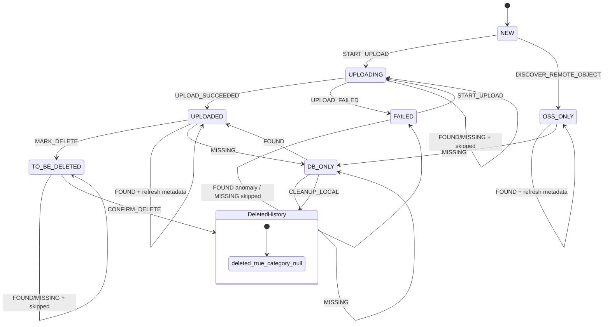

# HiveRecord 状态机

## 设计边界

`HiveRecord.status` 只描述 active record 的业务状态。删除不是 `status`，而是外层生命周期：

- `deleted = false` 且 `category_id IS NOT NULL`：active record。
- `deleted = true` 且 `category_id IS NULL`：历史记录，保留 `file_key` / `file_name`，不参与文件列表、同步匹配、下载、预览、分组。

因此不新增 `DELETED` 状态，避免出现 `deleted=true` 与 `status=DELETED` 的双源事实。

## 状态定义

- `UPLOADING`：上传中，OSS 对象可能尚未完整写入。
- `UPLOADED`：DB 与 OSS 已匹配，可下载、预览、分组、按策略删除。
- `FAILED`：上传失败，可重新上传进入 `UPLOADING`。
- `OSS_ONLY`：OSS 有对象，但 DB 没有解密元数据，不允许自动变成 `UPLOADED`。
- `DB_ONLY`：DB 有记录，但当前扫描未在 OSS 发现对象，不走普通 OSS 删除。
- `TO_BE_DELETED`：用户已标记删除，等待执行 OSS 删除。同步不应修改该状态。

## 状态转移图

代码实现中将 `HiveRecord.status == null` 映射为内部状态 `NEW`。`NEW` 不会持久化到数据库，只用于表达新建记录的合法转移。

## 禁止转移

- `TO_BE_DELETED -> UPLOADING`：同名文件必须先执行删除后再上传。
- `TO_BE_DELETED -> UPLOADED/DB_ONLY/OSS_ONLY`：同步不允许覆盖用户删除意图。
- `OSS_ONLY -> UPLOADED`：缺少 `file_name` 解密材料，不能自动转为可解密记录。
- `DB_ONLY -> TO_BE_DELETED`：本地孤儿记录不走普通 OSS 删除流程。

## 操作语义

### 上传

- 新文件：`START_UPLOAD -> UPLOADING`。
- `FAILED`：允许重新上传，`FAILED -> UPLOADING`。
- `UPLOADED`：视为已存在，直接返回 file key。
- `UPLOADING`：返回 `409 Conflict`。
- `TO_BE_DELETED`：返回 `409 Conflict`，要求先执行删除。
- `DB_ONLY` / `OSS_ONLY`：返回 `409 Conflict`，要求先清理或重新同步确认。

### 标记删除与执行删除

- 只有 `UPLOADED` 可以 `MARK_DELETE -> TO_BE_DELETED`。
- 只有 `TO_BE_DELETED` 可以 `CONFIRM_DELETE`。
- `CONFIRM_DELETE` 会删除 OSS 对象、缩略图、分组关系，然后设置 `deleted=true` 和 `category_id=NULL`。

### 清理本地记录

- 只有 `DB_ONLY` 可以 `CLEANUP_LOCAL`。
- 清理本地记录不调用 OSS delete，只清理 DB 关系、缩略图元数据和本地缓存，然后设置 `deleted=true` 和 `category_id=NULL`。

### 远程同步

远程同步由方法名区分 OSS 扫描结果：

- `applyRemoteFound(...)`：OSS 本次扫描发现对象。
- `applyRemoteMissing(...)`：OSS 本次扫描没有发现对象。
- `discoverRemoteObject(...)`：OSS 有对象但没有 active DB 记录，创建 `OSS_ONLY` 远端孤儿记录。

状态机返回 `SyncOutcome` 供 `HiveSyncService` 统计，不由 sync 服务按 status 自行分支。

| Observation | From | To | Effect | Outcome |
| --- | --- | --- | --- | --- |
| 新发现对象 | `NEW` | `OSS_ONLY` | `DISCOVER_REMOTE_OBJECT` 创建远端孤儿记录 | `OSS_ONLY` |
| `applyRemoteFound` | `UPLOADED` | `UPLOADED` | 刷新远端元数据并计算 `deletable` | `MATCHED` |
| `applyRemoteFound` | `DB_ONLY` | `UPLOADED` | 恢复远端匹配并计算 `deletable` | `MATCHED` |
| `applyRemoteFound` | `OSS_ONLY` | `OSS_ONLY` | 刷新远端元数据，保持不可删除 | `OSS_ONLY` |
| `applyRemoteFound` | `UPLOADING` | `UPLOADING` | 不修改状态、同步时间或删除策略 | `SKIPPED` |
| `applyRemoteFound` | `FAILED` | `FAILED` | 不修改状态、同步时间或删除策略 | `OSS_TO_DB_MISMATCHED` |
| `applyRemoteFound` | `TO_BE_DELETED` | `TO_BE_DELETED` | 不修改状态、同步时间或删除策略 | `SKIPPED` |
| `applyRemoteMissing` | `UPLOADED` | `DB_ONLY` | 更新时间并设为不可删除 | `DB_TO_OSS_MISSING` |
| `applyRemoteMissing` | `DB_ONLY` | `DB_ONLY` | 更新时间并保持不可删除 | `DB_TO_OSS_MISSING` |
| `applyRemoteMissing` | `OSS_ONLY` | `DB_ONLY` | 更新时间并设为不可删除 | `DB_TO_OSS_MISSING` |
| `applyRemoteMissing` | `UPLOADING/FAILED/TO_BE_DELETED` | 原状态 | 不修改状态、同步时间或删除策略 | `SKIPPED` |

`SKIPPED` 表示 sync 遇到上传中、上传失败且远端缺失、或待删除等操作态，选择不覆盖用户动作或操作结果；它不计入异常统计。

## 实现位置

- 状态表与转移校验：`HiveRecordStateService`。
- 上传入口：`HiveUploadService`。
- 标记删除、执行删除、本地清理：`HiveFileController`。
- 远程同步：`HiveSyncService`。
